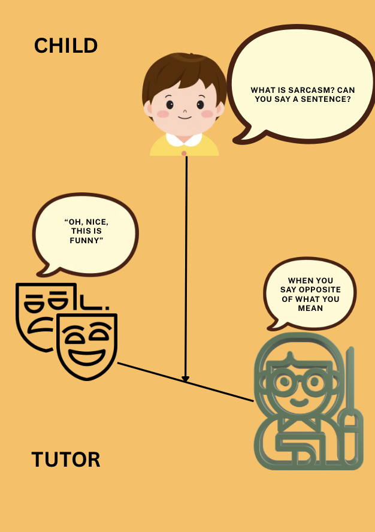
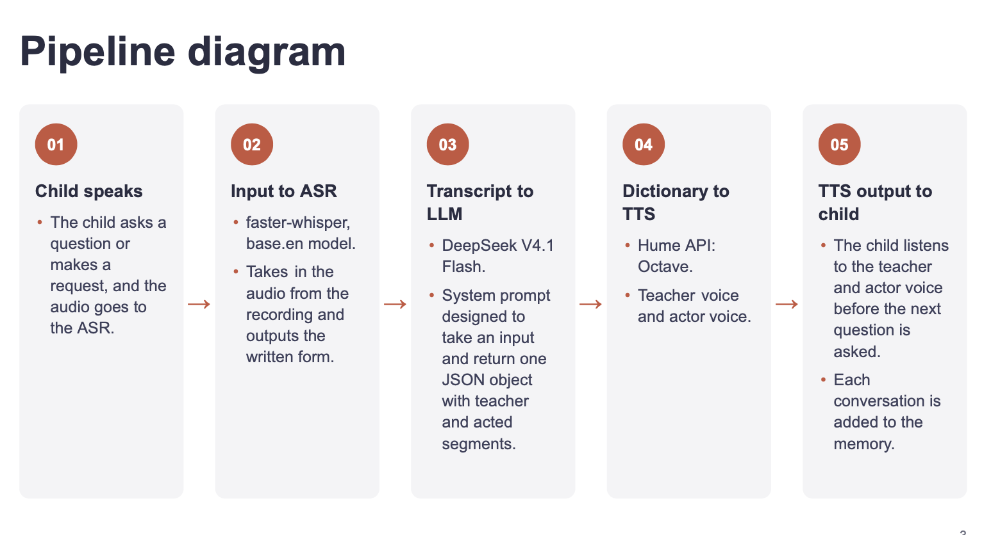

# Emotional Tutor

### Overview

An emotional tutor designed for children, with the purpose of tutoring a child by answering any relevant questions, and acting out emotions, since there are fewer tools for chilrdren.




## Setup

```bash
pip install -r requirements.txt
```

## Quickstart
```bash
pip install -r requirements.txt
cd emotion_tutor
python main.py

```
**Requirements:** Python 3.10+, Hume API key, Deepseek API key

## Project structure

```
├── emotion_tutor/
│   ├── asr.py               
│   ├── audio.py             
│   ├── clients.py          
│   ├── llm.py               
│   ├── tts.py               
│   ├── main.py              
│   ├── introduction.mp3     
│   └── conclusion.mp3       
├── images/                 
├── requirements.txt
└── README.md
```

## Pipeline
- It follows the following pipeline (Speech input → ASR → LLM → emotional TTS → spoken answer):


